# ERPNext HRMS & Business Application Portfolio

## About Me

I am an ERP Engineer, ERPNext Functional Consultant, Implementation Engineer, and Frappe Developer from India.

I work on ERP implementation, business process automation, HRMS customization, and custom business application development.

## Project Overview

This repository showcases my experience and portfolio in ERPNext HRMS and custom business application development.

## Key Features

### Employee Management

* Employee Information Management
* Employee User Linking
* Employee-wise Access

### Attendance Management

* Employee Check-in / Check-out
* Mobile Attendance Integration
* Attendance Tracking

### Leave Management

* Leave Application
* Leave Balance
* Leave Approval Workflow
* Manager Approval
* HR Final Approval

### Technical Development

* Python
* Frappe Framework
* REST API
* Flutter
* SQL
* JavaScript

## ERPNext Functional Expertise

* ERPNext Implementation
* Purchase Management
* Inventory Management
* Sales Management
* Manufacturing
* Quality Management
* HRMS
* Business Process Analysis
* Custom Reports and Dashboards

## Technology Stack

| Technology | Purpose               |
| ---------- | --------------------- |
| Python     | Backend Development   |
| Frappe     | Application Framework |
| ERPNext    | ERP Platform          |
| Flutter    | Android Development   |
| SQL        | Database              |
| HTML/CSS   | Frontend              |

## Services

* ERPNext Implementation
* ERPNext Functional Consulting
* HRMS Customization
* Attendance Management
* Leave Workflow Customization
* Frappe Application Development
* Custom Reports

## Contact

GitHub: https://github.com/omjaiswalerp

Location: India

Available for Freelance and Part-Time Projects.

---

---

# HRMS Application Screenshots

## 1. HRMS Dashboard
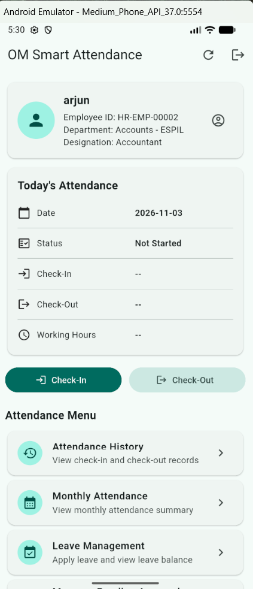

## 2. HRMS Dashboard Overview
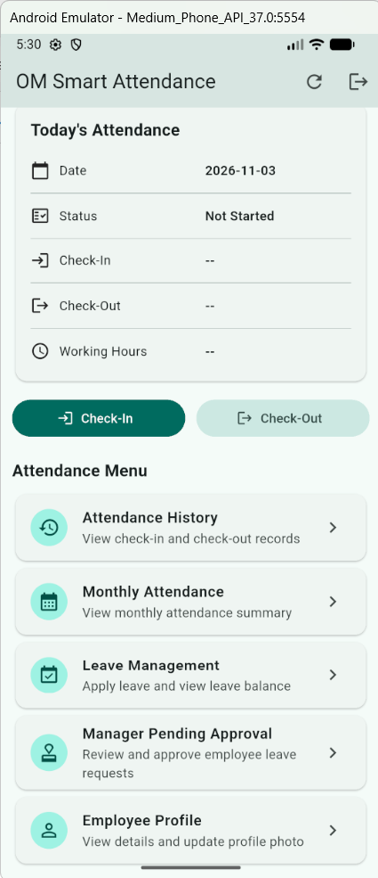

## 3. Employee Management
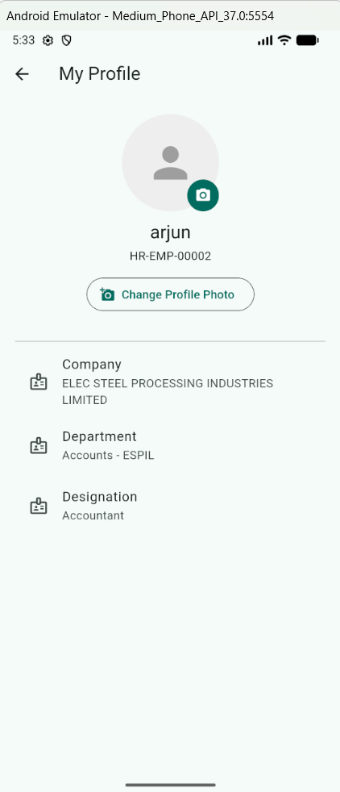

## 4. Employee Check-in / Check-out
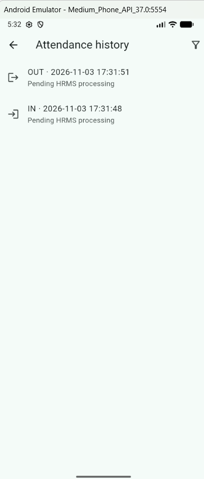

## 5. Attendance Management
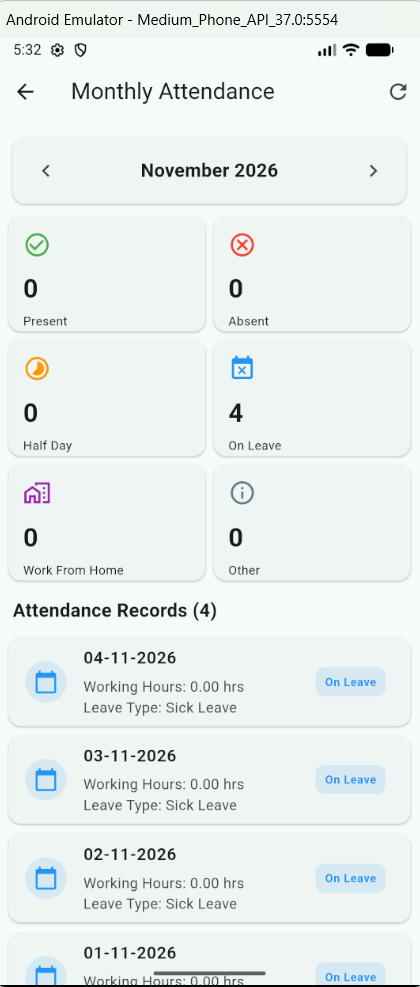

## 6. Leave Application
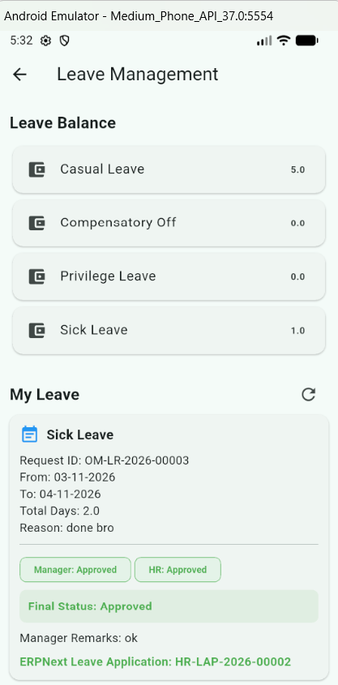

## 7. Leave Application Details
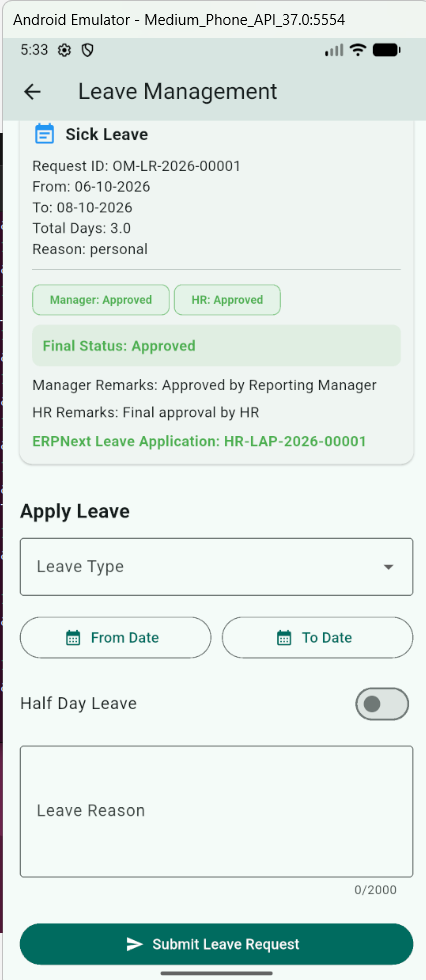

## 8. Leave Application Workflow
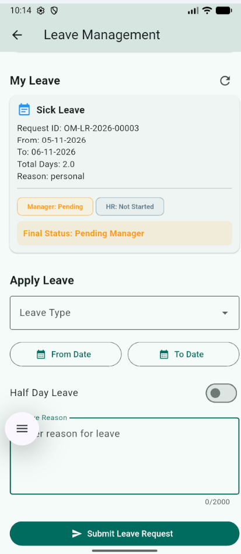

## 9. Leave Approval
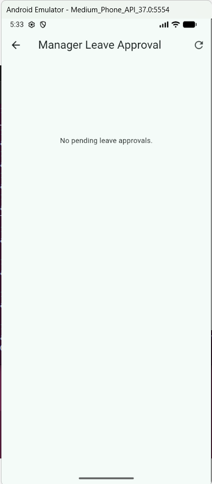

## 10. Leave Approval Process
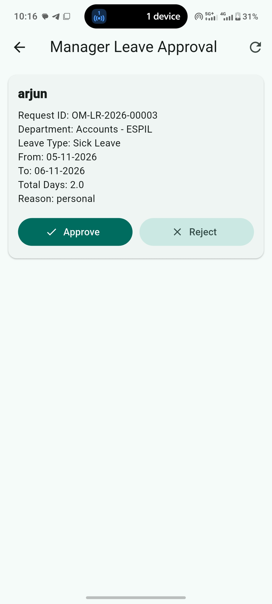

## 11. HR Final Approval
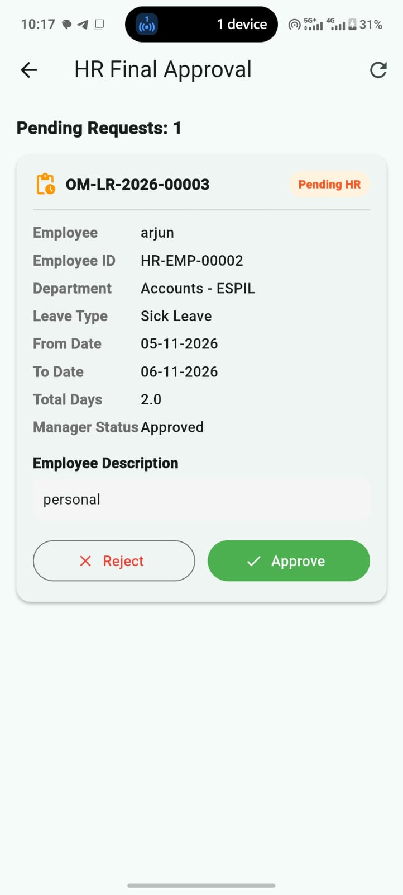

## 12. HR Approval Workflow
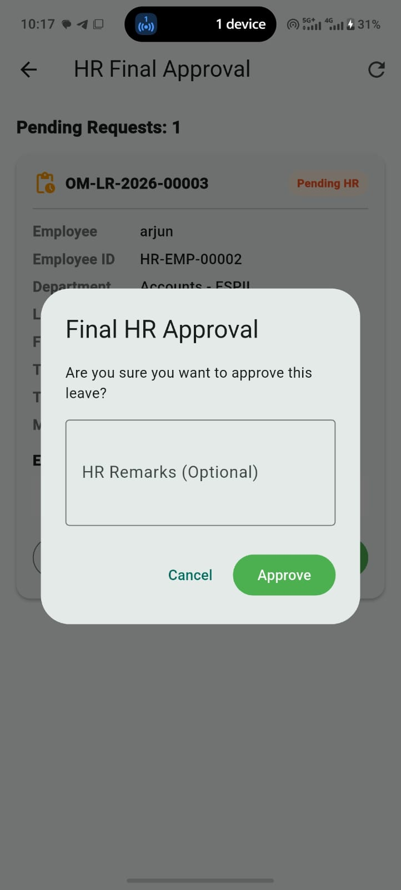

## 13. Leave Approved
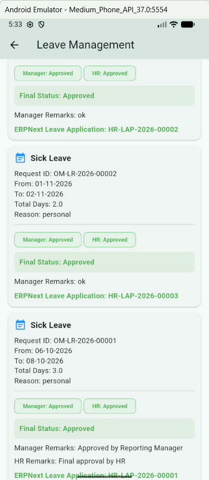

## 14. Office Location Settings

